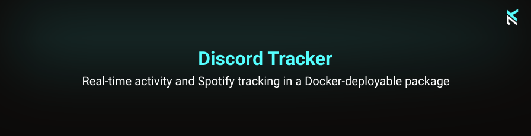

### 🚀 Introduction
Welcome to the Discord Activity Tracker Bot repository. This bot monitors configured users and broadcasts their Discord activities to specified channels. It includes optional Spotify track details and rotates through predefined status messages.

### ⏱️ Features
* **Activity Tracking**: Tracks what users are playing, listening to, or watching in real-time.
* **Spotify Integration**: Displays details about songs being played on Spotify.
* **Rotating Status Messages**: Cycles through a predefined list of statuses every hour.
* **Dynamic User Management**: Supports user configuration via users.json for flexible activity tracking across multiple users.
* **Docker Support**: Easy to deploy and manage using Docker.

### 💻 Technologies

This bot is developed using:
* [Discord.js](https://discord.js.org/)
* [Node.js](https://nodejs.org/en)
* [TypeScript](https://www.typescriptlang.org/)
* [Docker](https://www.docker.com/) for simplified deployment

Use Node.js 24 LTS (the image pins 24.22.1) and pnpm 12.15.0. Install dependencies
with `pnpm install --frozen-lockfile`. `pnpm start` compiles the TypeScript sources
before running the bot; the container runs the precompiled output directly.


### 🐳 Installation and Setup

To set up the Discord Activity Tracker Bot, follow these instructions:

1. **Clone the Repository**: 
   Clone the repository to your machine or server.
   ```bash
   git clone https://github.com/nicokempe/discord-tracker.git
   ```

2. **Set Up Environment Variables**:

- Copy the `.env.example` file to a new file named `.env`.
   ```bash
   cp .env.example .env
   ```

- Edit the `.env` file and replace the placeholder value with your actual Discord bot token.
  ```env
  DISCORD_TOKEN=your_actual_discord_bot_token
  ```
  
3. **Configure User Tracking**: The bot allows tracking multiple users dynamically through a users.json file. This file specifies which users the bot should track and in which channels to post updates.

   Create a `config` directory in the project root and add your own `users.json` file. This file is not included in the repository and must be supplied by you.

   Example `users.json`:

    ```json
    {
      "users": [
        {
          "userId": "1234567890",
          "channelId": "9876543210",
          "broadcast": false,
          "prefix": ":boom:",
          "mentionUser": true
        },
        {
          "userId": "0987654321",
          "channelId": "5678901234",
          "broadcast": true,
          "prefix": ":star:",
          "mentionUser": false
        }
      ]
    }
    ```

    The `broadcast` flag controls how updates are phrased. When set to `true`, updates are formatted for a public channel with the user's name. If `false`, messages address the user directly.

4. **Docker Setup**: Make sure Docker is installed on your system. Use the `Dockerfile` to build and run the bot with Docker.

    **Build and run with Docker**:

    ```bash
    docker build -t discord-tracker .
    docker run -d --name discord-tracker --env-file .env -v "$(pwd)/config:/usr/src/app/config:ro" discord-tracker
    ```
   
    -   The `users.json` should be placed inside the `config` folder in your project root, and Docker will mount this directory at runtime.

5. **Start the Bot**: After setting everything up, start the bot. It will automatically begin tracking the specified users and post updates to the designated channels.

### 🚀 Usage

After setting up, the bot will automatically start tracking the users specified in `users.json` and rotate its status. It will also post updates about their activities in the designated Discord channels. Ensure the bot has the necessary permissions in your Discord server to function properly.

### 📝 Contributing

Run `pnpm run typecheck` and `pnpm test` before submitting changes. Tests cover
activity notifications, Spotify details, permission checks, login failure and
the compiled health probe. Run `pnpm run release:check` to validate the release
tooling. The **Validate** workflow checks the frozen lockfile, release tooling,
types, tests and both container platforms on pull requests and pushes to `main`.

Contributions to the Discord Activity Tracker Bot are welcome. Please feel free to fork the repository, make your changes, and submit a pull request. For major changes, please open an issue first to discuss what you would like to change.

### Releases and published containers

Use **Actions → Release → Run workflow** on `main` to prepare a Berlin calendar
version (`YYYY.M.N`) and changelog in a release pull request. After its checks pass
and it is merged, run **Release** again to tag the reviewed `main` commit, create
the GitHub Release and publish signed AMD64/ARM64 containers to
`ghcr.io/nicokempe/discord-tracker`. The workflow respects branch protection and
retains the release version, commit, `latest` and existing `main` image tags.
See [RELEASING.md](RELEASING.md) for the two phases, scan artifacts and retries.

### Container health

The image checks `http://127.0.0.1:8080/healthz` every 30 seconds. It returns 200
only while the Discord client and gateway are ready, and 503 during startup or
gateway disconnects. The probe has a 2-second deadline, Docker allows 3 seconds,
startup has a 60-second grace period and three failed checks mark it unhealthy.
An unresponsive event loop also fails the probe. The listener binds to loopback
inside the container; no port publication or new secret is needed. Failed login
exits non-zero so an existing restart policy can retry.

The official Zabbix Docker template maps this state to `1 = starting`,
`2 = unhealthy`, `3 = healthy`, `4 = none`. Pull the published image and recreate
existing containers to activate the image's healthcheck. A Docker restart policy
alone does not restart containers merely marked unhealthy.

The dependency refresh includes TypeScript 7, dotenv 18 and Discord.js 14.27.
The compiler now uses Node16 module resolution and targets ES2022. Both Docker
stages install from `pnpm-lock.yaml` with `--frozen-lockfile`; ts-node is removed.

### 📜 License

This project is licensed under the MIT License - see the LICENSE file for details.
